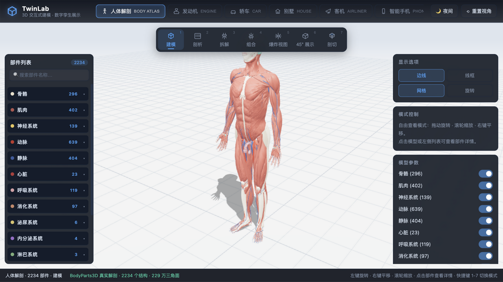
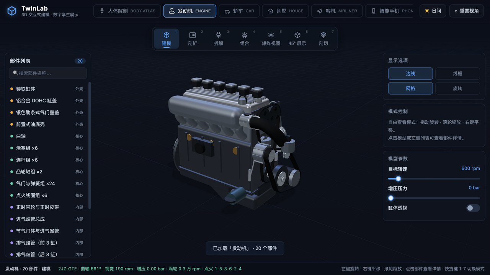
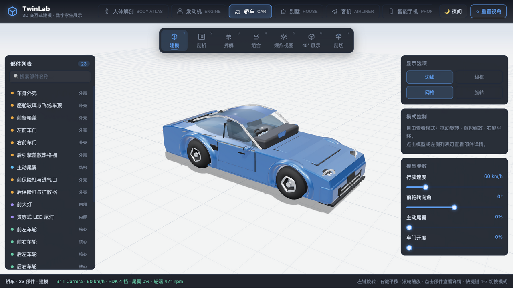
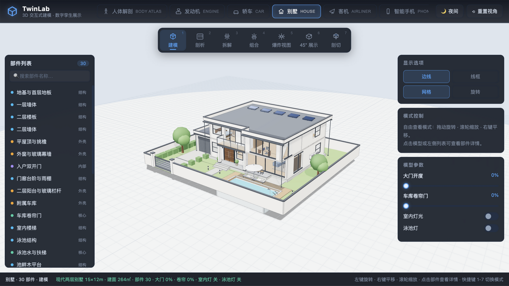
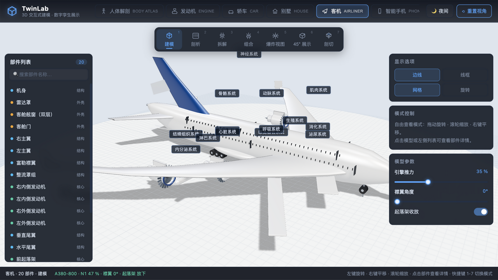
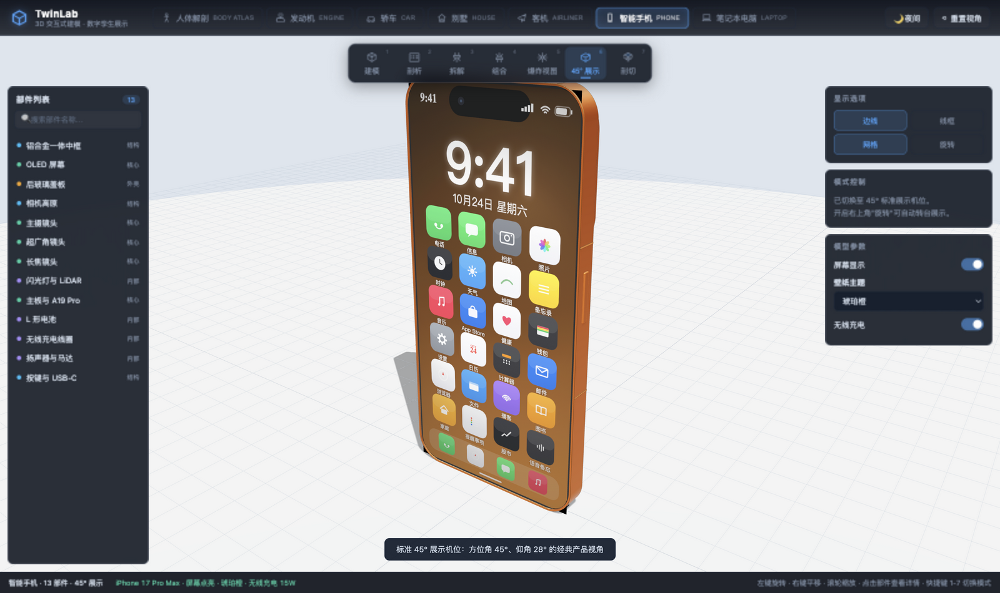

# TwinLab · 3D 交互式建模 / 数字孪生展示网站

**3D Interactive Modeling & Digital Twin Showcase** — 基于纯前端 Three.js 的交互式 3D 展示平台：7 大类产品级程序化建模 × 7 种工程展示模式，无需任何后端与外部模型文件。

A pure front-end Three.js platform for interactive 3D presentation: 7 categories of product-grade procedural models × 7 engineering display modes — no backend, no external model assets.

   

## 在线体验 / Live Demo

**https://shawloong-m.github.io/twinlab-3d/**

推送到 `main` 分支后 CI 自动构建部署（`.github/workflows/deploy.yml`）。/ Pushes to `main` are built and deployed automatically by GitHub Actions.

## 预览 / Preview

| | |
|---|---|
|  |  |
|  |  |
|  |  |

## 简介 / Introduction

**中文**：TwinLab 是一个数字孪生理念的产品展示平台——除了人体解剖使用真实医学数据外，其余全部模型均由代码"制造"：曲轴连杆按真实运动学往复，机翼按 NACA 翼型沿展向放样，车身经顶点级曲面 sculpting。每个模型都可拆解到零部件级，支持零部件拾取、参数联动与实时 HUD 读数，适合产品演示、教学讲解与数字孪生可视化场景。

**English**: TwinLab is a product showcase platform built around the digital-twin idea — apart from the human anatomy (real medical data), every model is "manufactured" by code: crankshafts reciprocate with real kinematics, wings are lofted from NACA airfoil sections, car bodies are sculpted vertex-by-vertex. Each model can be disassembled down to component level with per-part picking, live parameter coupling and HUD readouts — ideal for product demos, education and digital-twin visualization.

## 功能特性 / Features

- **7 种展示模式 / 7 display modes**（快捷键 1–7）: 建模 Modeling · 剖析 X-Ray · 拆解 Disassembly · 组合 Assembly · 爆炸视图 Exploded · 45° 展示 Turntable · 剖切 Section Cut
- **零部件级拾取 / Part-level picking**：包围盒粗筛 + 三角形精确相交，点击显示名称与工程说明 / bounding-box pre-filter + exact triangle intersection; click any part for its name & engineering description
- **实时参数联动 / Live parameter coupling**：转速、增压、尾翼、襟翼、起落架、开合角……每个模型都有独立参数面板与 HUD / every model ships its own parameter panel + HUD
- **昼夜双光照 / Day & night lighting**：天空、雾、网格、模型灯光（车灯/屏幕/泳池灯）全套切换 / full scene swap incl. model lights
- **性能工程 / Performance engineering**：系统合并渲染（2234 结构 → 15 draw calls）、InstancedMesh 舷窗与键帽、按需阴影 / system-merged rendering, instanced windows & keycaps, on-demand shadow maps

## 七大模型 / The Seven Models

### 1. 人体解剖 / Human Anatomy（BodyParts3D）

**中文**：2234 个命名解剖结构 · 229 万三角面 · 15 大系统（骨骼 296 / 动脉 639 / 静脉 404 / 肌肉 402 / 神经 139 等）。数据来自 DBCLS BodyParts3D 真实解剖图谱，按系统合并渲染、按系统爆炸展示，每个结构可点击查看 FMA 编号与归属系统。

**English**: 2,234 named anatomical structures · 2.29M triangles · 15 systems (skeletal 296 / arterial 639 / venous 404 / muscular 402 / nervous 139 …). Data from DBCLS BodyParts3D; merged per system for rendering, exploded per system for display, every structure clickable with FMA ID.

### 2. 发动机 / Engine（丰田 Toyota 2JZ-GTE）

**中文**：直列六缸双涡轮 1:1 建模。6 缸曲柄连杆真实相位运动学（点火顺序 1-5-3-6-2-4），DOHC 凸轮轴 1:2 减速，正时皮带与多楔带闭环精确相切联动，CT20 双涡轮随增压压力 spool，满负荷排气歧管烧红。

**English**: A 1:1 inline-6 twin-turbo. True 6-cylinder crank-slider kinematics (firing order 1-5-3-6-2-4), DOHC camshafts at half crank speed, closed-loop serpentine & timing belts with exact tangency, twin CT20 turbos spooling with boost, exhaust manifolds glowing red-hot at full load.

### 3. 轿车 / Car（保时捷 Porsche 911 (992) Carrera）

**中文**：4.52m 真实比例。飞线快背车顶、贯穿式 LED 尾灯、可升降主动尾翼、五联圆仪表、后置 3.0T 水平对置六缸 + 8 速 PDK、前窄后宽车轮（245/40 R19 · 295/35 R20）、黄色卡钳，车门/转向/滚轮/夜灯全联动。

**English**: True 4.52m proportions. The 911 flyline roof, full-width LED tail strip, deployable active spoiler, 5-dial cockpit, rear-mounted 3.0L twin-turbo boxer-6 with 8-speed PDK, staggered wheels (245/40 R19 · 295/35 R20), yellow calipers — doors, steering, rolling wheels and night lights all coupled.

### 4. 客机 / Airliner（空客 Airbus A380-800）

**中文**：全长 72.72m、翼展 79.75m、总高 24.09m。双层卵形机身与上下双排舷窗、标志性的 22 轮起落架（前 2 + 翼下 4×2 + 机身 6×2）、4 台 GP7270 翼吊发动机（22 叶可旋转风扇）、33.5° 后掠 NACA 翼型机翼、上下双叉翼梢翼刀、富勒襟翼偏转与起落架收放动画。

**English**: 72.72m long, 79.75m span, 24.09m tall. Double-deck ovoid fuselage with two window rows, the iconic 22-wheel landing gear (nose 2 + wing 4×2 + body 6×2), four GP7270 wing-mounted engines with 22-blade spooling fans, 33.5° swept NACA-airfoil wings, A380 wingtip fences, Fowler-flap deflection and gear retraction animation.

### 5. 智能手机 / Smartphone（iPhone 17 Pro Max）

**中文**：163.03 × 77.58 × 8.75mm 真实尺寸（宇宙橙）。全宽相机高原 + 三摄三角布局（抛光铝圈 + 蓝宝石镜片 + 微反光）、LiDAR 与闪光灯、灵动岛、USB-C、L 形电池与 A19 Pro 主板堆叠；Canvas 实时绘制屏幕 UI（4 套主题）、无线充电呼吸光环。

**English**: True 163.03 × 77.58 × 8.75mm (Cosmic Orange). Full-width camera plateau with a triangular triple-camera stack (polished rings, sapphire lenses, inner reflections), LiDAR & flash, Dynamic Island, USB-C, L-shaped battery and A19 Pro board stack; canvas-drawn screen UI (4 themes) and a breathing MagSafe charge ring.

### 6. 别墅 / Villa（现代两层平顶别墅 / Modern Two-Storey Villa）

**中文**：15×12m 两层平顶现代别墅，配套齐全：8×4m 泳池（水下灯+扶梯）、车库卷帘门（可卷动 21 片帘板）、二层阳台玻璃栏杆、围墙电动平移门、屋顶太阳能板、空调外机，室内客厅/餐厨/卧室/书房全屋家具，夜间室内/庭院/泳池灯光联动。

**English**: A 15×12m modern villa, fully equipped: 8×4m pool (underwater lights + ladder), roller-shutter garage door (21 animated slats), 2F balcony with glass railing, perimeter wall with sliding gate, rooftop solar array, AC units, and full interior furnishing — living, dining, kitchen, bedroom and study — with synchronized night lighting.

### 7. 笔记本电脑 / Laptop

**中文**：CNC 三明治机身：C/D 面之间镁铝合金中框骨架，侧壁 I/O（双 USB-C / 双 USB-A / HDMI / SD）。屏幕开合角阻尼动画、双风扇转速联动、Canvas 桌面画面、内存/SSD/电池堆叠可拆解。

**English**: CNC sandwich chassis: a magnesium-alloy mid-frame between C/D covers with side I/O (2× USB-C, 2× USB-A, HDMI, SD). Damped lid hinge animation, coupled dual-fan speeds, canvas desktop wallpaper, and a teardown-ready RAM/SSD/battery stack.

## 技术架构 / Architecture

```
┌───────────────────────── 浏览器 / Browser ─────────────────────────┐
│  index.html（顶栏/模式条/左右面板/信息卡/状态栏 UI 骨架）              │
│                                                                    │
│  app.js      应用装配：UI 生成 / 模式控制 / 参数面板 / 拾取高亮 / 主循环 │
│  viewer.js   3D 视口：场景·灯光·昼夜·相机适配·射线拾取·剖切平面        │
│  modes.js    展示模式：爆炸插值·装配动画·X光·标注·Atlas 目录式布局     │
│  lib.js      造型工具箱：材质工厂·放样·扫掠·Metaball·CAD 描边         │
│  registry.js 模型注册表：新增一个 build() 即自动生成全部 UI 入口       │
│  models/*    七个模型文件，统一契约 { group, parts, params, update } │
└────────────────────────────────────────────────────────────────────┘
        │ fetch（gzip 分块流式解压，仅解剖模型）
        ▼
public/models/bodyparts3d/  atlas.json + body-N.bin.gz（BodyParts3D 数据）
```

**English**: `app.js` wires the UI, modes and the render loop; `viewer.js` owns scene/lighting/camera/picking/clipping; `modes.js` implements the 7 presentation modes incl. the atlas catalog layout; `lib.js` is the modeling toolbox (materials, lofts, sweeps, metaballs, CAD edges); `registry.js` auto-generates UI for any model that registers a `build()`; `models/*` are the seven model files sharing one contract `{ group, parts, params, update }`.

## 实现方式 / Implementation Highlights

- **程序化建模 / Procedural modeling**：所有几何由代码生成，零外部资源（除解剖数据）/ every mesh is generated by code — zero external assets except anatomy data
- **CAD 曲面放样 / Lofted surfaces**：机身卵形截面 `superellipsePts` 沿轴线多站位放样，机翼/垂尾 `airfoilPts` 翼型放样，车身顶点级宽度渐变与 tumblehome sculpting
- **真实运动学 / Real kinematics**：曲柄连杆 `y = r·cosθ + √(L²−r²sin²θ)`、6 缸相位差、凸轮 1:2、皮带外切线闭环算法、起落架/尾翼阻尼动画
- **性能管线 / Performance pipeline**：系统级网格合并（2234 → 15 draw calls）、`InstancedMesh`（舷窗 384 扇/键盘 70 键）、`shadowMap.autoUpdate=false` 按需阴影、`DecompressionStream` 原地解压 gzip
- **爆炸与装配 / Explode & assembly**：部件按"外层先拆、内层先装"计算交错延迟，Atlas 采用目录式等尺寸布局 + 系统标签

## 目录结构 / Project Structure

```
├── index.html                  # 页面骨架 / UI skeleton
├── src/
│   ├── app.js                  # 主应用 / application wiring & main loop
│   ├── viewer.js               # 3D 视口 / viewport, lighting, picking
│   ├── modes.js                # 展示模式 / display modes
│   ├── lib.js                  # 造型工具箱 / modeling toolbox
│   ├── registry.js             # 模型注册表 / model registry ★
│   └── models/                 # 七个模型 / the seven models
│       ├── humanAtlas.js       #   人体解剖 / human anatomy
│       ├── engine.js           #   丰田 2JZ-GTE
│       ├── car.js              #   保时捷 911 (992)
│       ├── airplane.js         #   空客 A380-800
│       ├── phone.js            #   iPhone 17 Pro Max
│       ├── house.js            #   现代别墅 / modern villa
│       └── laptop.js           #   笔记本电脑 / laptop
├── public/models/bodyparts3d/  # 解剖数据（gzip 分块）/ anatomy data
├── docs/screenshots/           # README 截图 / screenshots
└── .github/workflows/deploy.yml # Pages 自动部署 / CI deploy
```

## 快速上手 / Getting Started

```bash
npm install      # 安装依赖（three + vite）/ install dependencies
npm run dev      # 开发服务器 → http://localhost:5173
npm run build    # 生产构建 → dist/
npm run preview  # 本地预览生产构建 / preview the production build
```

## 使用指南 / Usage

**操作 / Controls**

| 操作 / Action | 说明 / Description |
|---|---|
| 左键拖动 / Left drag | 旋转 / orbit |
| 滚轮 / Wheel | 缩放 / zoom |
| 右键拖动 / Right drag | 平移 / pan |
| 点击部件 / Click part | 显示信息卡与黄色包围盒 / info card + highlight box |
| 快捷键 1–7 / Keys 1–7 | 切换展示模式 / switch display mode |
| `N` / `R` / `Esc` | 昼夜切换 / 重置视角 / 取消选择 |

**运行时 API / Runtime API**

```js
window.DTW.registerModel({ id, name, build });  // 控制台注册新模型 / register a new model
window.DTW.loadModel('my-model');
window.DTW.list();
```

**新增模型 / Add your own model**

在 `src/models/` 新建文件并实现契约 `build() → { group, parts, params, update }`，再到 `registry.js` 注册一行，界面即自动生成全部模式入口。每个部件通过 `part()` 注册并携带 `{ name, en, role: shell|structure|internal|core, desc }`，可选 `explode: [x,y,z]` 指定爆开方向。详见 `src/models/registry.js` 内注释与现有模型示例。

Create a file in `src/models/`, implement `build() → { group, parts, params, update }`, register it in `registry.js` — the UI, modes, picking and parameter panel are all generated automatically. Register each part via `part()` with `{ name, en, role, desc }` and an optional `explode` vector. See `registry.js` and the existing models as references.

## 部署 / Deployment

仓库内置 GitHub Actions 工作流（`.github/workflows/deploy.yml`）：推送 `main` 分支即自动构建并发布到 GitHub Pages。若自建，请保持 `vite.config.js` 的 `base: './'`（相对路径，适配任意子路径托管）。

The repo ships with a GitHub Actions workflow — pushes to `main` build and publish to GitHub Pages automatically. The Vite `base: './'` keeps the build portable to any sub-path host.

## 许可 / License

- 代码 / Code：[MIT](LICENSE)
- 解剖数据 / Anatomy data：[BodyParts3D](https://lifesciencedb.jp/bp3d/) © DBCLS，[CC BY-SA 2.1 JP](https://lifesciencedb.jp/bp3d/?lng=en)——分发或衍生数据请遵循相同许可并注明来源 / share alike with attribution
- 产品名称与图形商标（Porsche / Apple / Airbus 等）仅用于建模演示，与本仓库无隶属关系 / Product names & trademarks are used for modeling demonstration only, no affiliation.
